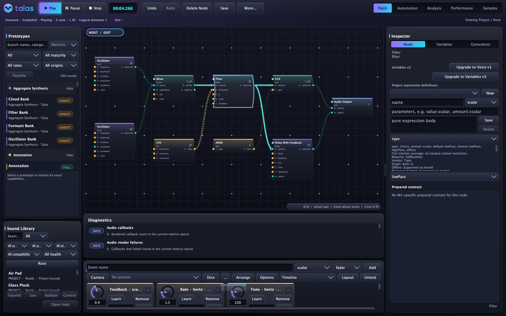
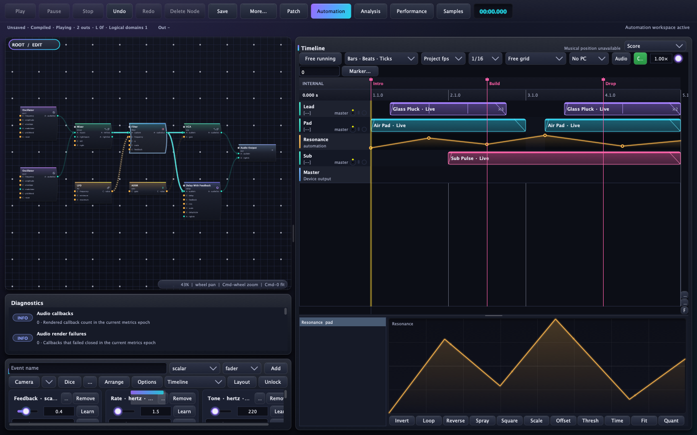
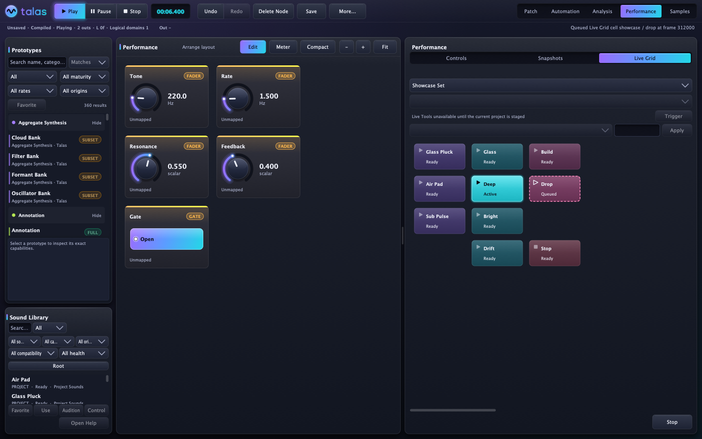
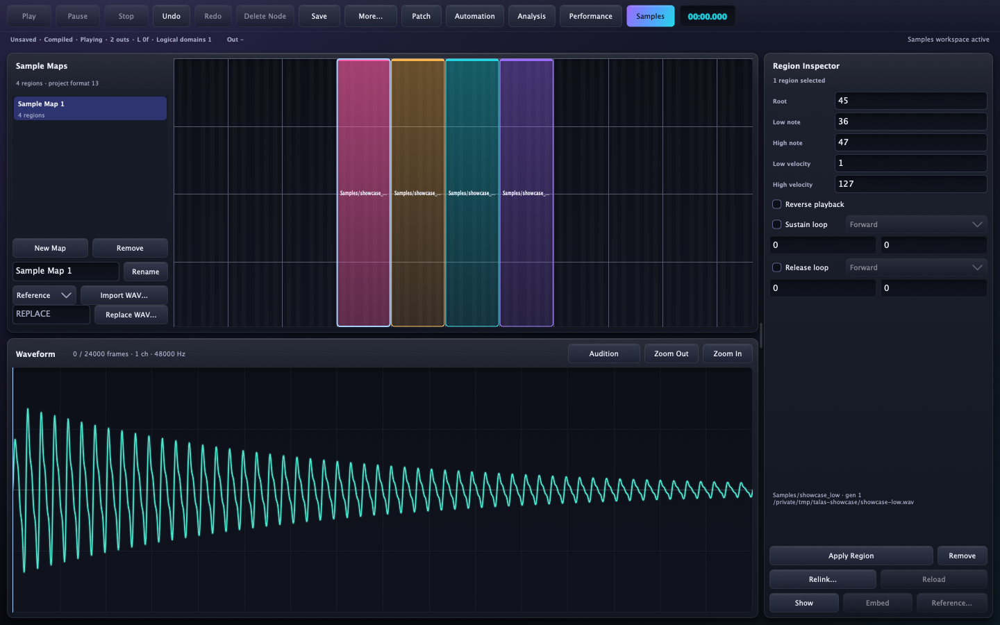

# Talas Workbench

**Talas** is an open-source sound-design workbench and audio engine. You build
a sound as a graph of modules, such as oscillators, filters, envelopes, grain
clouds, spectral resynthesis and sequencers. You can play the graph live with
MIDI and on-screen controls, or render it offline to a WAV file. Both paths use
the same engine and give the same result.



The Workbench is a native desktop app written in C++20 with
[JUCE](https://juce.com). Underneath it is a JUCE-free core library and a
command-line tool, `talas_cli`, which load, check and render the same project
files without a GUI.

> **Status: early and pre-release.** Talas builds from source and has a large
> automated test suite, but it has no binary releases yet and project formats
> may still change. See the [roadmap](#roadmap).

## Features

- **364 built-in modules** in more than 30 categories:
  - sources, oscillators and wavetables;
  - filters, dynamics, delays and reverb;
  - sampling and disk playback, grain and sample clouds;
  - additive and aggregate synthesis;
  - FFT analysis, spectral modifiers and resynthesis;
  - envelopes, LFOs, sequencers, MIDI in and out, live-input tracking, spatialization.
- **132 CDP processes.** A provider module brings in spectral and time-domain
  processes ported from the [Composers Desktop Project](https://www.composersdesktop.com)
  (CDP8).
- **Nested, reusable Sounds.** Turn part of a graph into a Sound with its own
  inputs and exposed parameters. You can use it many times, and every instance
  keeps its own state.
- **Expressions in every parameter field.** Write `440 hz`, `60 nn` or
  `!Frequency * 2`. Any `!Name` you type becomes a live control (a fader, gate or
  toggle) that you can drive from MIDI, the Timeline or a snapshot.
- **Live performance tools:**
  - snapshot banks with recall, morphing and seeded randomization;
  - an 8×16 Live Grid that launches Sounds, snapshots and Score markers in
    time with the beat;
  - MIDI learn and OSC.
- **Timeline and Score.** Keyframed control lanes with step or linear
  interpolation and sample-accurate loops.
- **Samples workspace.** Multisample maps with key and velocity regions, loop
  markers and audition.
- **Analysis tools:**
  - an oscilloscope and spectrum analyzer with triggers, cursors and freeze;
  - analysis tools that build resonator filter tables (RE) and GA analyses
    from your own samples.
- **Your work is protected:**
  - autosave, with the last twenty unsaved versions kept for recovery;
  - detection of edits made to the project file outside Talas;
  - self-contained `.talaspkg` packages that copy every asset;
  - checks on asset files: SHA-256 identity and relinking when a file goes missing.
- **Realtime-safe engine.** The audio callback does not allocate or lock, and
  the graph is prepared and checked before it reaches the audio thread.

## Screenshots

| Timeline | Live Grid | Samples |
| --- | --- | --- |
| [](docs/images/talas-timeline.png) | [](docs/images/talas-live-grid.png) | [](docs/images/talas-samples.png) |

These are made by `talas_workbench --render-screenshots <folder>`, which lays
the Workbench out around a built-in showcase project without opening audio or
MIDI devices; see the [Workbench and CLI reference](docs/workbench-and-cli-reference.md#screenshots).

## Roadmap

These are the next milestones, in this order:

1. **Interface overhaul.** A modern look with strong colours, gradients and glass-like
   panels.
2. **Demo projects and presets.** 20–30 ready-to-play projects, from effects to
   synthesizers.
3. **Plugin export** (done on macOS). Turn your own project into a VST3 or AU
   instrument or effect that runs in a DAW, from File > Export Plugin... or
   `talas_cli export-plugin`, with no compiler; see
   [Plugin export](docs/plugin-export.md). Windows and Linux are not verified yet.
4. **Releases.** macOS, Windows and Linux builds, made and checked by hand.

## Building from source

You need:

- CMake 3.28 or newer;
- a C++20 compiler (recent Clang, GCC or MSVC);
- Python 3, for the generated-documentation checks in the test suite;
- JUCE 8.0.15, for the Workbench only. The Workbench preset downloads it for you.

Development currently happens on macOS. The core is portable C++20; Windows and
Linux builds will be checked before the first release.

### Core library and CLI

The default build doesn't use JUCE or the network:

```bash
cmake --preset core-debug
cmake --build --preset core-debug
ctest --preset core-debug
```

### Workbench app

The `workbench-release` preset downloads JUCE 8.0.15 and builds the app:

```bash
cmake --preset workbench-release
cmake --build --preset workbench-release
```

On macOS the app is
`build/workbench-release/talas_workbench_artefacts/Release/Talas Workbench.app`.

To build against a JUCE checkout you already have:

```bash
cmake -S . -B build/workbench-debug \
  -DTALAS_BUILD_WORKBENCH=ON \
  -DTALAS_FETCH_JUCE=OFF \
  -DTALAS_JUCE_PATH=/path/to/JUCE
cmake --build build/workbench-debug --target talas_workbench
```

## Command-line quick start

Projects are JSON files with the extension `.talas.json`. The
[examples folder](examples/README.md) holds runnable projects.

Create a starter project:

```bash
./build/core-debug/talas_cli init --template oscillator --output my-sound.talas.json
```

Render it to a WAV file:

```bash
./build/core-debug/talas_cli render --project my-sound.talas.json --duration 2 --sample-rate 48000 --output my-sound.wav
```

Check a project without rendering, and see its prepared graph: outputs,
latency and resources:

```bash
./build/core-debug/talas_cli validate --status --project my-sound.talas.json
```

Draw the graph with Graphviz:

```bash
./build/core-debug/talas_cli graph --project my-sound.talas.json --format dot | dot -Tsvg > my-sound.svg
```

List every module and its ports and parameters:

```bash
./build/core-debug/talas_cli catalog --format json
```

Run `talas_cli --help` for every command: playing back MIDI files, setting
live controls with `--event`, analysis tools and CDP processing.

## Repository layout

| Path | Contents |
|---|---|
| `src/core`, `include/talas/core` | module registry, descriptors and expressions |
| `src/runtime` | graph compiler, offline renderer and realtime engine |
| `src/project` | project file format and migrations |
| `src/dsp`, `src/audio` | DSP building blocks and audio file readers and writers |
| `src/app` | the JUCE Workbench |
| `src/cli` | `talas_cli` |
| `third_party/cdp` | CDP8-derived processes (LGPL-2.1) |
| `examples` | runnable example projects |
| `tests` | unit, integration, realtime and documentation tests |
| `docs` | design records, module reference and test notes |

## Documentation

- [Module reference](docs/help/builtin-node-reference.md): every built-in
  module with its ports, parameters and examples.
- [Capability matrix](docs/coverage/capability-matrix-v2.md): which modules
  run offline and in realtime, and their known limits.
- [Workbench and CLI reference](docs/workbench-and-cli-reference.md): detailed
  notes on the app and the command-line tool.
- [Plugin export](docs/plugin-export.md): turning a project into a VST3 or AU
  instrument or effect, its parameters, limits and licensing.
- [Product](PRODUCT.md) and [design](DESIGN.md) notes.
- [Architecture decision records](docs/adr/README.md).

## Contributing

Bug reports and pull requests are welcome. Before you commit, run the local
gate. It does a Release build with warnings treated as errors and then runs the
complete test suite:

```bash
tools/local_gate.sh
```

[CONTRIBUTING.md](CONTRIBUTING.md) has the rest of the development rules.

## License

The original Talas code is licensed under Apache-2.0; see `LICENSE`.
`third_party/cdp/` holds code derived from the Composers Desktop Project's
CDP8 under the LGPL-2.1 (see its `NOTICE.md` and
[ADR-0018](docs/adr/0018-cdp-provider-module.md)); a binary that links it and
is distributed must meet that license. The optional Workbench links JUCE, so
JUCE's license also applies to a built Workbench application.
