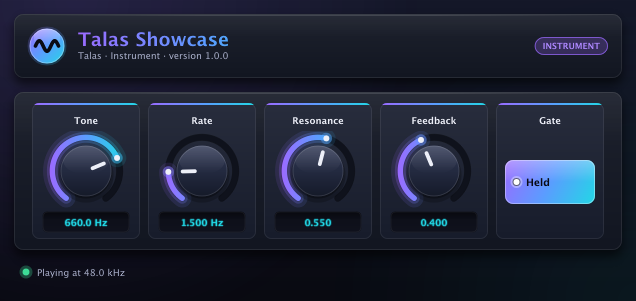

# Plugin export

Talas turns a project into a VST3 or AU plugin that runs in a DAW. You need
no compiler: an export copies a prebuilt template plugin, puts your project and
the plugin's name inside it, and signs it. Exporting takes about a second.

Exporting works on macOS, which builds both formats. The design is in
[ADR-0029](adr/0029-plugin-export-from-template-bundles.md).

## What you get

- An **instrument** plays your project from the host's MIDI, with stereo
  output. Use it for projects whose MIDI Voices or MIDI Mappers play
  *Live MIDI* (their source blank or `Live MIDI`). The demo instruments in
  [`examples/demos`](../examples/demos/README.md) are built this way.
- An **effect** feeds the track's audio into the project's live audio input
  and plays the result in stereo. Host channels 1 and 2 become project input
  channels 1 and 2. If the project reads only input channel 1, as the demo
  effects do, that channel gets left and right mixed together.

Each export is a `<Name>.vst3` bundle and, on macOS, a `<Name>.component`
(AU) bundle. Both play the project in the same realtime engine as the
Workbench's Play button.

The plugin's editor wears the Workbench's look: a knob with a lit readout for
each fader, a pad for each toggle or gate, and the engine's status below.



## Exporting

### From the Workbench

Open the project and choose **File > Export Plugin...**. The dialog asks for:

- **Name**: what the host lists. It defaults to the project's title.
- **Manufacturer**: hosts group plugins by manufacturer. The default is
  `Talas`.
- **Kind**: Instrument or Effect. A project with a Live MIDI voice starts as an
  instrument, and one that reads live input starts as an effect.
- **Formats**: VST3, and AU on macOS.
- **Folder**: where the bundles are written. The default is
  `Documents/Talas Plugins`.

The dialog exports the project as it is open, including unsaved edits. When it
finishes, it lists the bundles it wrote.

### From the command line

```bash
talas_cli export-plugin --project examples/demos/sub_bass.talas.json \
  --name "Sub Bass" --kind instrument --output ~/Desktop/Plugins
```

| Option | Meaning |
| --- | --- |
| `--project <path>` | A `.talas.json` file or `.talaspkg` package. |
| `--name <name>` | The plugin's name, at most 63 bytes. |
| `--kind instrument\|effect` | What the plugin is. |
| `--output <dir>` | Where the bundles go. The folder is created if it is missing. |
| `--format vst3,au` | One or both formats. The default is both on macOS and VST3 elsewhere. |
| `--manufacturer <name>` | The manufacturer, `Talas` by default. |
| `--manufacturer-code <code>` | Four characters, at least one of them upper case. Derived by default. |
| `--plugin-code <code>` | An upper-case letter, then three lower-case letters or digits. Derived by default. |
| `--version <x.y.z>` | The plugin's version, `1.0.0` by default. Each part is 0 to 255. |
| `--template-dir <dir>` | A folder to search for templates first. You can repeat it. |
| `--no-sign` | Skip ad-hoc signing on macOS. An unsigned bundle does not load on Apple silicon. |

The command prints the bundles it wrote, the plugin's codes, any latency and
the parameters. Warnings go to standard error.

### Using the plugin

To use the plugin, copy the bundle into your plug-in folder and rescan in your
DAW. On macOS the folders are `~/Library/Audio/Plug-Ins/VST3` for `.vst3`
bundles and `~/Library/Audio/Plug-Ins/Components` for `.component` bundles.
Talas never installs plugins itself.

## Names and codes

Hosts tell plugins apart by codes, not names:

- The **manufacturer code** is the manufacturer's first four letters or
  digits, with the first upper case: `Talas` gives `Tala`. Shorter names are
  padded from a hash.
- The **plugin code** is a hash of the manufacturer and the name, written as
  one upper-case letter and three lower-case letters or digits.

If you export again with the same manufacturer and name, the plugin keeps its
codes, so the host sees an update rather than a new plugin. Sessions that use
it keep working. Before using a derived code, the exporter checks the other
Talas exports in the output folder and in your plug-in folders. If a different
plugin already holds the code, it picks the next one. You can also set both
codes yourself.

## Parameters

The host sees the project's live controls as parameters:

1. The project's **Virtual Controls**, in their order. These are the controls
   on the Virtual Control Surface, which the demos all declare.
2. Then any **Event Value** the project reads without a control (`!Name` in a
   field). It gets the range its name implies (for example `!Cutoff`,
   `!GainDB` or `!BPM`) or 0 to 1.

A plugin shows at most 128 parameters. For each one:

- A **fader** becomes a continuous parameter with the control's range, default,
  log taper and grid.
- A **toggle** or **gate** becomes a switch.
- The control's label is the parameter's name. A trailing unit such as "(Hz)",
  "(s)", "(ms)" or "(dB)" becomes the parameter's unit.

An instrument leaves out the MIDI-driven names, such as `!cc07`, `!sw64` and
`!MIDIPitchBend`. The host sets those through MIDI, as a MIDI keyboard does in
the Workbench.

Host changes reach the project as Event Value changes at the start of each
audio block. Automation is therefore accurate to the block, not to the
sample.

When the host starts the plugin, the project starts from the parameters'
values. The plugin's saved state holds each parameter by name, plus a hash of
the embedded project. A session saved with an older export of the same
plugin restores every parameter whose name still exists.

The plugin's window shows its name and a knob or switch for each parameter, in
the Workbench's look.

## What gets embedded

The bundle's `Contents/Resources` holds:

- `talas-plugin.json`: the plugin's identity.
- `project.talas.json`: the project.
- `assets/`: copies of the samples and tables the project references, if it
  has any. The embedded project points at these copies.
- `moduleinfo.json`, in a VST3: the plugin's name and class IDs, for hosts
  that list plugins without loading them.

Before writing anything to the output folder, the exporter loads and compiles
the embedded project from inside the new bundle, the same way the plugin will.
A project that does not compile, or whose assets cannot be found, fails the
export instead of producing a plugin that does not play.

## Limits

- **Automation** is accurate to the block, not to the sample (see
  Parameters).
- **Values fixed at start.** Some projects fix a value when the Sound starts,
  such as some reverb or detector settings (the demos' README lists them). A
  change to such a parameter takes effect only after the host restarts the
  plugin, for example when you change the sample rate or reload the plugin.
- **Host transport.** The plugin does not follow the host's transport or
  tempo. The project's own tempo and Timeline run from when the plugin starts.
- **Demo phrases.** The demo instruments play their phrase when the Sound
  starts, while their `Demo phrase` switch is on. Turn the switch off in the
  host, or set the control to off in the project before exporting.
- **Latency.** The plugin reports the project's latency to the host. For
  example, CDP spectral processing in Spectral Blur adds 109 ms. Notes keep
  their exact timing within each block, but a project's MIDI Voices and
  envelopes can start them a few milliseconds late, as in the Workbench.
- **Channels.** Plugins are stereo. A project that reads input channels above
  2 gets silence on them, and outputs beyond 2 are not heard.
- **Parameter order in AU hosts.** AU hosts list parameters in the order of
  their internal IDs, not the project's order. The plugin's own window keeps
  the project's order.
- **Plugin size.** Every plugin contains the whole Talas engine, about 30 MB.
- **Platforms.** Only macOS is built and tested. The Windows and Linux code
  paths exist, but nothing on those platforms is verified yet. Windows and
  Linux have VST3 only.

## Licensing

An exported plugin is a copy of a Talas template, so it contains:

- **JUCE 8**, licensed under the AGPLv3 unless you hold a commercial JUCE
  licence.
- **The CDP code** in `third_party/cdp`, licensed under the LGPL-2.1. The
  Talas runtime always links it, whether or not your project uses CDP
  modules.
- **The original Talas code**, licensed under Apache-2.0.

To share or sell a plugin you export, you must meet those licences. Under the
AGPLv3 that means offering the complete corresponding source. Under the
LGPL-2.1 it means letting users relink the plugin with a changed CDP
library. Plugins you only use yourself are not distributed. The export dialog
and `talas_cli export-plugin` both show a short version of this notice.

## Building the templates

The templates build with the Workbench. `TALAS_BUILD_PLUGINS` is on by
default when `TALAS_BUILD_WORKBENCH` is on:

```bash
cmake --build build/workbench-release --target talas_plugin_templates
```

The build collects the templates in `<build>/PluginTemplates`, where a
`talas_cli` built in the same folder finds them. It also copies them into
`Talas Workbench.app/Contents/Resources/PluginTemplates`.

Without `--template-dir`, the exporter searches these places in order:

1. The folders in the `TALAS_PLUGIN_TEMPLATES` environment variable.
2. `PluginTemplates` next to the program.
3. `PluginTemplates` in the program's app bundle `Resources`.
4. `../share/talas/PluginTemplates`.

A raw template, one with nothing embedded, also works as a plugin:
`Talas Effect` passes audio through unchanged, and `Talas Instrument` plays a
saw voice.
